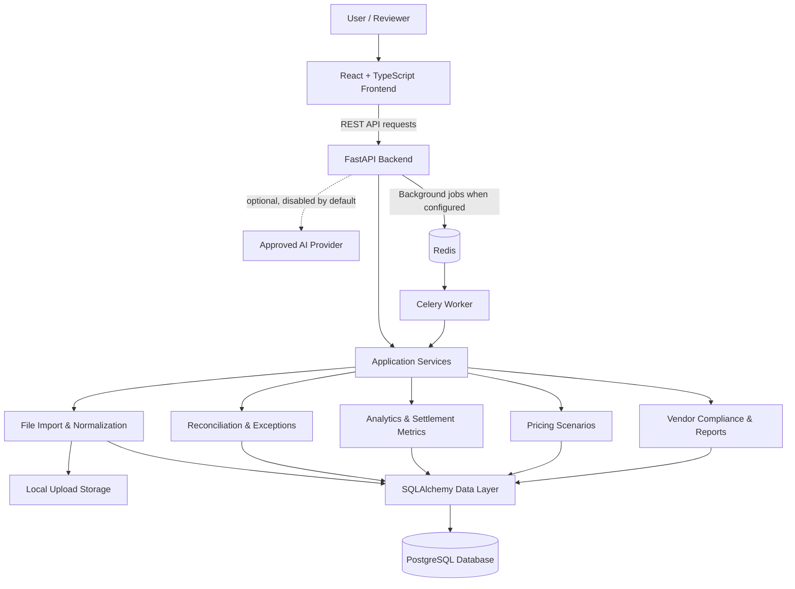
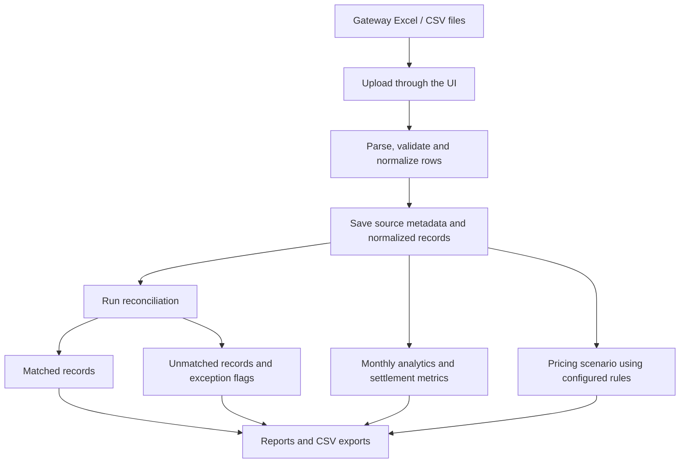
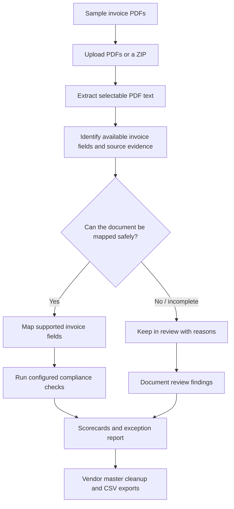

# FinOps AI --- Architecture Guide

## 1. What is this project?

**FinOps AI** is an independent portfolio demo for finance operations.
It brings two workflows into one web application:

1.  **Payment gateway analysis:** import payment-provider spreadsheets,
    reconcile records, review exceptions, analyze fees and settlement
    timing, and create illustrative pricing scenarios.
2.  **Vendor compliance review:** import sample invoice PDFs, extract
    available fields, flag missing evidence, review GST/TDS-related
    checks, and export scorecards and cleanup reports.

The application helps people investigate data. It does **not** claim
that every flagged item is a confirmed loss or a legal violation.

## 2. Architecture at a glance

### The main parts, in plain English

  -----------------------------------------------------------------------
  Component                           What it does
  ----------------------------------- -----------------------------------
  **React + TypeScript frontend**     The pages, forms, charts, tables,
                                      filters, and downloads the user
                                      interacts with.

  **FastAPI backend**                 Receives frontend requests,
                                      validates inputs, runs application
                                      workflows, and returns API
                                      responses.

  **Application services**            Contain the main logic for imports,
                                      reconciliation, analytics, pricing
                                      scenarios, vendor checks, and
                                      reports.

  **SQLAlchemy**                      Connects the Python application to
                                      the database and maps application
                                      objects to database records.

  **PostgreSQL**                      Stores normalized transactions,
                                      import metadata, reconciliation
                                      results, vendor/invoice records,
                                      compliance findings, and related
                                      application data.

  **Local upload storage**            Keeps uploaded source files
                                      separately from normalized database
                                      records.

  **Redis + Celery (optional for      Redis carries queued work; a Celery
  background processing)**            worker processes supported
                                      background jobs. Run both for more
                                      dependable asynchronous
                                      imports/reconciliation.

  **AI provider (optional)**          Can provide an explanation of an
                                      exception when explicitly enabled
                                      and configured. AI is disabled by
                                      default and does not settle
                                      payments or make compliance
                                      decisions.
  -----------------------------------------------------------------------

## 3. How a request travels through the app

For example, when a user opens Analytics:

1.  The frontend sends a request to a FastAPI endpoint under `/api/v1`.
2.  FastAPI calls the relevant application service.
3.  The service reads the required normalized records through
    SQLAlchemy.
4.  PostgreSQL returns the data.
5.  The backend calculates or assembles the response.
6.  The frontend displays the result in a chart or table.

The dashboard and reports are designed to use persisted application data
rather than hardcoded dashboard totals.

## 4. Workflow A --- Payment gateway analysis

**What happens:**

-   The user uploads a gateway workbook and chooses the relevant dataset
    type.
-   The importer parses rows, checks for validation issues and
    duplicates, and stores normalized data with source provenance.
-   Reconciliation links records where matching evidence is available
    and flags unmatched or inconsistent records for review.
-   Analytics summarizes observed volume, transaction counts, fees, and
    settlement timing by relevant dimensions such as month, gateway, and
    currency.
-   Pricing scenarios estimate costs from the rules entered by the user.
-   The Reports page provides a printable executive summary and CSV
    exports.

**Important distinctions:**

-   Fees found in the workbooks are **observed fees**, not independently
    verified contract rates.
-   Exception flags can overlap; counting all flags as separate losses
    would be misleading.
-   Settlement timestamps in a provider export are not the same as
    independent bank proof of receipt.
-   Pricing results are estimates. In particular, the current fixed-fee
    scenario logic applies the configured fixed fee once per scenario;
    it does not model a per-transaction fixed-fee count. Do not present
    such scenarios as confirmed savings or contract quotes.

## 5. Workflow B --- Vendor GST/TDS compliance review

**What happens:**

-   The user imports sample invoice PDFs.
-   `pypdf` extracts selectable text; OCR is not configured for scanned
    or image-only documents.
-   The application records source filenames, file hashes, extraction
    status, and evidence for extracted fields.
-   Only documents with sufficient supported fields are mapped into the
    current invoice model. Other document types or incomplete records
    remain available for review.
-   Compliance checks produce scorecards, exceptions, and vendor master
    cleanup findings.
-   Users can download CSV reports for further review.

**Important distinctions:**

-   An invoice PDF alone cannot prove GST registration status, operative
    PAN, GSTR-2B presence, payment, TDS deposit/reporting, or MSME
    status.
-   Missing evidence should remain visible as a gap rather than being
    treated as proof of compliance or wrongdoing.
-   Tax rates and section mappings should be approved by qualified
    reviewers before they are used for operational decisions.
-   Scorecards are review aids, not legal or tax opinions.

## 6. Where data is stored

  -------------------------------------------------------------------------------
  Data                    Location / system               Purpose
  ----------------------- ------------------------------- -----------------------
  Normalized payments,    PostgreSQL                      Querying,
  transactions, refunds                                   reconciliation,
  and related records                                     analytics, and reports

  Vendor, invoice,        PostgreSQL                      Compliance review and
  compliance, and cleanup                                 exports
  records                                                 

  Import jobs and source  PostgreSQL                      Tracking imports and
  provenance                                              tracing records back to
                                                          source files

  Uploaded workbooks and  Local storage under             Retaining source
  PDFs                    `backend/data/uploads/`         documents separately
                                                          from normalized rows

  Schema changes          `backend/alembic/`              Versioned database
                                                          migrations

  API routes              `backend/app/api/v1/routers/`   HTTP endpoints used by
                                                          the frontend

  Business logic          `backend/app/services/`         Import, analytics,
                                                          reconciliation,
                                                          pricing, and compliance
                                                          logic

  UI pages                `frontend/src/pages/`           User-facing screens
  -------------------------------------------------------------------------------

Source files and local uploads should not be committed to a public
repository unless they are explicitly approved for sharing. Keep
environment files and credentials private.

## 7. Technology stack

-   **Frontend:** React, TypeScript, Vite, TanStack Query, Recharts
-   **Backend:** Python, FastAPI, Pydantic Settings
-   **Database:** PostgreSQL, SQLAlchemy 2, Alembic
-   **Background jobs:** Celery and Redis
-   **Spreadsheet ingestion:** pandas, openpyxl, xlrd
-   **PDF text extraction:** pypdf
-   **Optional AI explanations:** OpenAI or Anthropic SDKs, disabled
    unless explicitly enabled

## 8. Running locally

Use the exact prerequisites and commands in [`README.md`](README.md). At
a high level:

1.  Install Python, Node.js, and PostgreSQL.
2.  Create a local database and configure `backend/.env` using the
    example configuration.
3.  Install backend dependencies and run `alembic upgrade head`.
4.  Start the API with Uvicorn.
5.  Install frontend dependencies and start the Vite development server.
6.  Optionally start Redis and the Celery worker for background jobs.
7.  Open the frontend in a browser and import the sample datasets.

The README includes the detailed Windows PowerShell commands, health
endpoint, API documentation URL, and import walkthrough.

## 9. API and user interface

The frontend communicates with the backend through REST endpoints under
`/api/v1`. The running OpenAPI page lists the available endpoints and
schemas.

Local URLs documented by the project:

-   Frontend: `http://localhost:5173`
-   Backend health: `http://localhost:8000/health/ready`
-   Interactive API documentation: `http://localhost:8000/api/docs`

## 10. Security and limitations

-   Use only dummy or appropriately masked data in this demo.
-   Keep `.env` files, passwords, and API keys out of source control.
-   AI is disabled by default. If enabled, use only an approved provider
    and separately verify its data-retention settings.
-   The application is a demonstration and is not hardened for public
    production deployment.
-   No independent bank-transfer ledger or signed gateway contract rates
    are included in the supplied payment data.
-   Vendor invoice samples do not include all external evidence required
    for authoritative tax verification.
-   Outputs should be reviewed by finance or tax professionals before
    being used for business decisions.

## 11. Related documentation

-   [`README.md`](README.md) --- installation, setup, and demo
    walkthrough
-   [`accuracy-report.md`](accuracy-report.md) --- test history,
    verification evidence, assumptions, and known limitations

------------------------------------------------------------------------

**In one sentence:** the React frontend is the interface, FastAPI runs
the workflows, PostgreSQL stores the application data, and the
import/reconciliation/compliance services turn source files into
reviewable analytics and reports.
